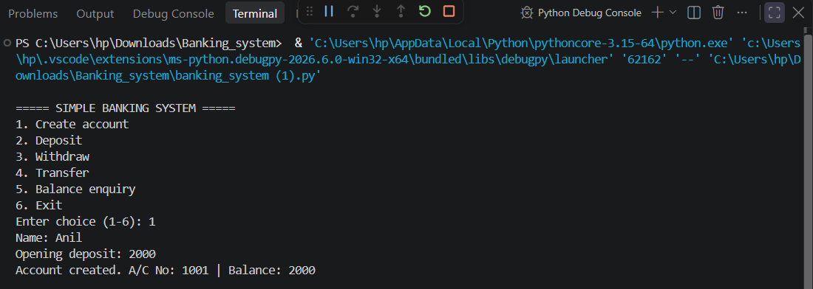
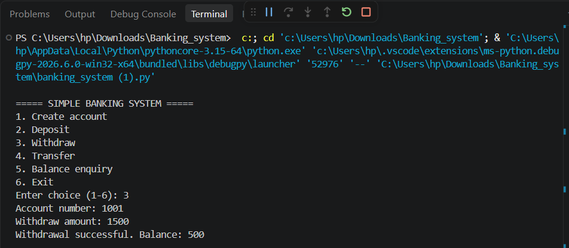
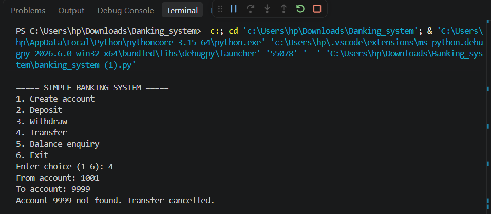

Student Details:

Name: D.Viswajith
Enrollment No: RU-26-01108
Course: B.Tech Computer Science and Engineering (1st Semester)
University: Rungta International Skills University

Simple Banking System:

A console-based banking application written in Python 3. Customers can open an account, deposit money, withdraw money, transfer money to another account and check their balance. All account data is saved in a text file (bank.txt), so it is not lost when the program is closed.

Problem Statement:

Create a banking application that lets customers open an account, deposit, withdraw, transfer money and check their balance, with all data stored in a file.

Rules:

Account numbers start from 1001.
A minimum balance of Rs.500 must always remain in every account.
Data is stored in bank.txt.

Features:

1. Create account: enter a name and an opening deposit (at least Rs.500). The program gives a new unique account number.
2. Deposit: add money to an existing account.
3. Withdraw: take money out, but Rs.500 must always remain.
4. Transfer: send money from one account to another.
5. Balance enquiry: view the account number, name and balance.
6. Exit: close the program.

Input validation:

1. Menu choice must be 1 to 6.
2. Account numbers and amounts must be whole numbers.
3. Amounts must be greater than 0.
4. The name cannot be empty and cannot contain a comma (,).
5. Opening deposit must be at least Rs.500.
6. The program checks that the account exists before any deposit, withdrawal, transfer or enquiry.
7. A transfer to the same account is not allowed.

Concepts Used:

1. Loops: while True for the main menu and for re-asking after invalid input
2. Functions: separate function for each bank operation and helper tasks
3. Conditions: if / elif / else for menu choices and rule checks
4. File Handling: reading and writing bank.txt using pathlib.Path
5. Lists: each account is stored as [account_number, name, balance

Project Output:

Screenshots of the program execution are available in the "screenshots" folder.

## Project Output

### 1. Account Creation

### 2. Deposit

### 3. Withdrawal

### 4. Fund Transfer

