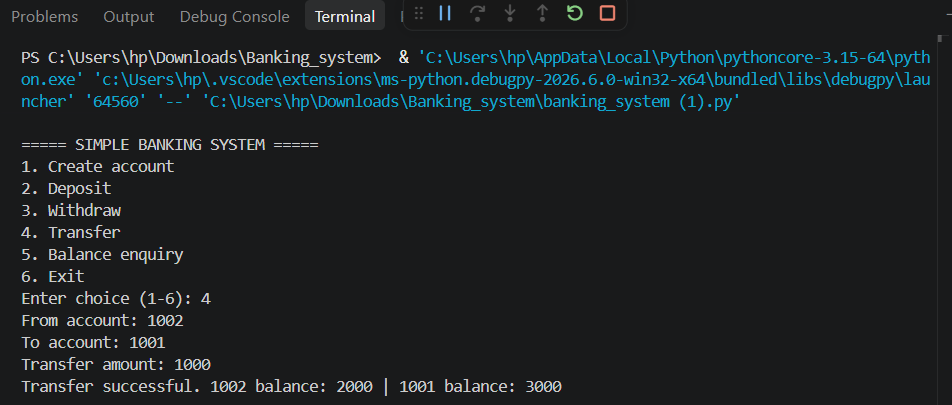

Banking Management System

About the Project

This is a Python-based Banking Management System that allows users to perform basic banking operations.

Technologies Used

- Python
- File Handling
- pathlib Module

Features

- Account Management
- Create and Manage Accounts
- Check Account Balance
- Deposit and Withdraw Money
- Store Account Details Using File Handling

Project Structure

- "banking_system (1).py" – Main Python program
- "bank.txt" – Stores account information
- "screenshots/" – Contains project output screenshots

Project Output

Screenshots of the program execution are available in the "screenshots" folder.

## Project Output

### 1. Account Creation

### 2. Deposit

### 3. Withdrawal

### 4. Fund Transfer

